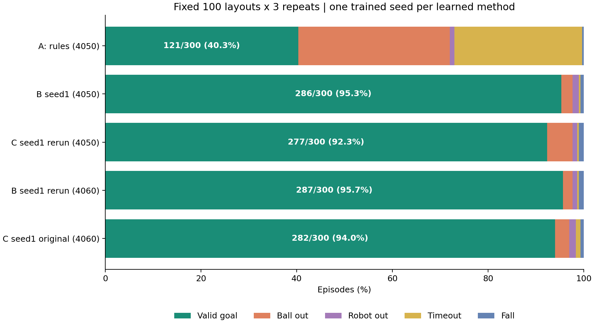
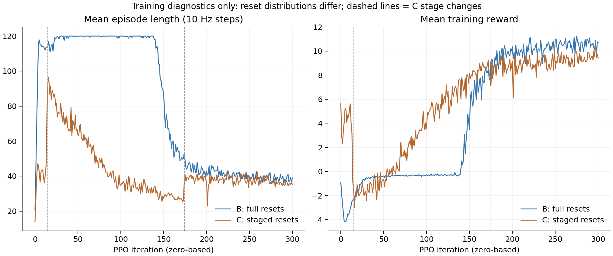

# Method C seed 1: verified results and PR #1 comparison

Method C completed 2,000 effective PPO iterations and scored **282/300 valid goals (94.0%)** on the original RTX 4060/WSL machine. Successful goals took **3.321 s mean**, **3.200 s median**, and **4.300 s p90**. This is one trained seed, evaluated on 100 fixed layouts three times.

## Artifacts

The [complete comparison ZIP](../results/soccer/c_seed1_20261025/microduck_C_seed1_comparison_20261025.zip) contains the final checkpoint, run configs, fixed evaluation set, per-episode outputs, accepted learning curve, recovery history and offline videos. Its SHA-256 is `b7b3ba1b1ae252c3b71a4cec1e91daffc76c1d715c219a0c64f55dd4e6ad287a`.

Readable files are also checked in under [results/soccer/c_seed1_20261025](../results/soccer/c_seed1_20261025). The result is based on actual policy updates, finite model tensors, optimizer step 40,000, a verified final checkpoint and completed episodes; it is not merely a model-load check.

| Original C seed 1 outcome | Episodes | Rate over all 300 |
|---|---:|---:|
| Valid goal | 282 | 94.0% |
| Ball out of bounds | 9 | 3.0% |
| Robot out of bounds | 4 | 1.33% |
| Timeout | 3 | 1.0% |
| Fall | 2 | 0.67% |

These failures do not overlap in this evaluation. Repeats scored 93/100, 95/100 and 94/100. There were 100 distinct layouts, not 300 independent layouts and not three training seeds.

## What PR #1 contains

[PR #1](https://github.com/8787greenhat/microduck_rl/pull/1), reviewed through `b375fc1d1eb2e60ce1f80e412e0c0b03a4eb0076`, contains:

1. B seed 1 results and behavior analysis in `docs/soccer.md`.
2. Saving/restoring the success-gated reset-curriculum state in `SoccerOnPolicyRunner`, respecting `MICRODUCK_WARM_START`.
3. A HW3 progress report and build files.
4. A documentation correction: B's early timeout/no-kick phase is approximately iterations 5–140.

The four soccer test modules passed **30 tests, one existing actuator-regex warning**, using a CPU-only isolated checkout at `25bb4d6`. The subsequent `b375fc1` changes only documentation; functional code is identical. No new training was run and the original C training checkout was not upgraded.

## B/C comparison after receipt of the original B data

The original B comparison archive was subsequently supplied through Discord. Its SHA-256 is `c4d1ea2a0b3fffdf656bb0e91ef9499672b61cc4c07fe2be84a88549f3aa60f1`. All **30 listed payload hashes**, ZIP CRCs and extracted-file bytes passed. The following table is now recomputed from the supplied CSV/tensors and checked against each summary, rather than copied from PR prose.

| Policy | Evaluation environment | Goals / 300 | Goal rate | Mean successful goal time |
|---|---|---:|---:|---:|
| A: geometric, 5 cm | Teammate RTX4050/native Linux | 121 | 40.3% | 4.873 s |
| B seed 1 | Teammate RTX4050/native Linux | 286 | 95.3% | 3.181 s |
| C seed 1, teammate rerun | Teammate RTX4050/native Linux | 277 | 92.3% | 3.287 s |
| B seed 1, new local rerun | RTX4060/WSL | 287 | 95.7% | 3.180 s |
| C seed 1, original evaluation | RTX4060/WSL | 282 | 94.0% | 3.321 s |

On the teammate machine, B has **9 more goals (+3.0 percentage points)** than C. Failure counts are B: ball out 7, robot out 4, timeout 1, falls 2; C: ball out 16, robot out 3, timeout 1, falls 3. Thus the net gap is mainly ball out-of-bounds. B's and C's successful-goal time averages use different successful subsets, so the 0.106 s difference is descriptive, not a paired timing effect.

Across the 300 matching layout/repeat IDs, both scored in 267, only B scored in 19, only C scored in 10, and neither scored in 4. Across the 100 unique layouts (three repeats each), B had more successful repeats in 15 layouts, C in 8, and they tied in 77. These are one-seed descriptive comparisons; the three repeats do not measure variation across trained policies. No algorithm-level significance or superiority claim is made.

### Independent B rerun on the original C machine

After auditing the supplied B checkpoint, we ran it **once** on the original RTX4060/WSL C machine, using the same pinned official evaluator, fixed JSON, evaluation RNG seed0, 100 layouts x3 repeats, fixed low-level models and driver/library environment. No policy training or parameter changes were performed; the first completed rerun is preserved. Safe `weights_only` checkpoint loading was enforced.

B scored **287/300 (95.7%)**, with mean successful goal time **3.180s**, against the original C evaluation **282/300 (94.0%)**, mean **3.321s**. The local point-estimate gap is therefore **5 goals, 1.67 percentage points**. B failures were ball out6, robot out3, timeout1 and falls3. Exact B checkpoint and evaluation-set hashes are in the [local rerun verification](../results/soccer/c_seed1_20261025/comparison_audit/B_on_4060/verification.json), with its [per-episode CSV](../results/soccer/c_seed1_20261025/comparison_audit/B_on_4060/per_episode.csv).

The original-machine paired outcome counts are {'both_goal': 275, 'B_only_goal': 12, 'C_only_goal': 7, 'neither_goal': 6}. This comparison removes the ambiguity about which B checkpoint we evaluated; it does not remove C's interrupted training or provide independent training-seed replication. B's success count was286 on the teammate machine and287 here; C was282 on its original machine and277 in the supplied teammate rerun. All runs are retained without choosing the best as a replacement result.

### What is now verified

- The **actual evaluation JSON is byte-identical** to the original C set, not merely the same generator seed. The Linux `uv.lock` is also byte-identical.
- The B checkpoint hash matches `run_info_B_seed1.json`; safe CPU-only tensor loading finds iteration 1999, `common_step_counter=240000`, optimizer step 40000 and finite actor/critic tensors.
- A literal-only YAML comparison finds agent differences only at `experiment_name`, `run_name`, and `logger`. The environment differs only by `curriculum.reset_layout`; no Python objects/functions from YAML were executed.
- B's supplied metadata records the same training commit, seed 1, 2048 environments, 24 rollout steps and 2000 iterations. Its startup Git-state record is clean. Declared frozen-skill hashes match our locally verified files; the B archive does not contain the low-level ONNX files themselves for independent rehashing.
- All A/B/teammate-C per-episode CSV flags and step counts match their supplied tensor files, and rates/times match their summaries. B's 2000-row training CSV also matches **60000 scalar values** from its original TensorBoard event file.
- B was Python3.12.3, native Linux, RTX4050, driver595.99.02; C's original machine was Python3.12.14, WSL, RTX4060, driver610.62. Core package versions and the dependency lock match. Preserve both C evaluation runs: the cause of their five-goal difference was not isolated and should not be attributed solely to the GPU.

One provenance detail remains: the B archive says the C checkpoint was hash-checked, but contains neither that C checkpoint nor its literal full SHA256. Its C **outcome files** are verified, while the link to our exact final C model remains an author-provided assertion. Our final C hash is recorded below so the rerun provenance can be completed.

The original B archive and checkpoint are not republished here; this PR adds the derived [verification record](../results/soccer/c_seed1_20261025/comparison_audit/received_B_verification.json), figures and comparison. The earlier C ZIP and its original 94.0% result remain unchanged.

### Early training observations and limits

At iterations 25/50/100, B's mean episode lengths were approximately 119/120/120 high-level steps (120 is the time limit), while C's were 81/63/35. C's easier resets appear to avoid the same early timeout-heavy phase in this one run. C entered stage1 at iteration15 and stage2 at iteration174; both transitions are verified in the accepted curve.

Training reward/episode length before iteration174 are measured on different reset distributions and must not be used to claim controlled sample efficiency. Stage2 still retains 20% easier resets: spending about91% of iterations in stage2 is not the same as using exactly B's reset distribution for91% of samples. To compare learning speed fairly, evaluate matching checkpoints on the fixed set; to compare algorithms beyond these trained policies, run independent training seeds. The archive's simple “not significant” standard-error calculation is not adopted as an algorithm-level conclusion.

## Reproducibility and recovery

- Training commit: `7fa62987d76dd2ba00ec15ffdd1de5bd93480845`.
- Training seed 1; 2,048 environments; 24 rollout steps/environment; 4 minibatches; 5 epochs; 2,000 effective iterations = 98,304,000 high-level transitions.
- Evaluation generator seed 20261023; evaluation RNG seed 0; 100 layouts × 3 repeats.
- Evaluation JSON SHA-256: `3a59dee2c22b5129fcb10685192630443a29550790ee5ccbffc04e414d053464`.
- Final checkpoint SHA-256: `8bda158d82f3e3834ebdc76028cadcc4584294d5e7cc751c84adc7d9d06b4de4`.
- Interrupted after a driver update; restored `model_200.pt` with stage 2 from its log, reinitialized physics episodes/counters, discarded the original iterations 201–267, then completed 201–1999. This is not a bit-exact uninterrupted run.
- `resume/agent.yaml` has `max_iterations: 1799` because that is the remaining count; the total budget is still 2,000. Save interval changed from 100 to 25 for recovery protection.
- The accepted learning curve includes original 0–200 and resumed 201–1999, excluding the discarded 67 updates. The discarded segment and diagnostic work still count toward compute spent.

The B configs, checkpoint, fixed set, outcome files and training curve have now been supplied and audited. Remaining work is the explicit C-rerun checkpoint identifier, matched-checkpoint held-out learning curves, and independent training seeds. No new training, reward changes or merges were initiated. One additional 300-episode B evaluation was performed, as documented above.
