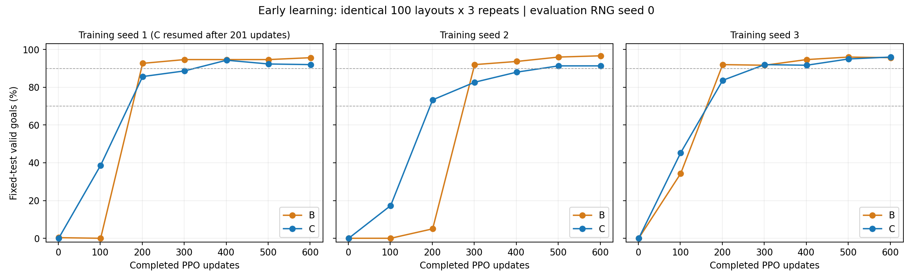
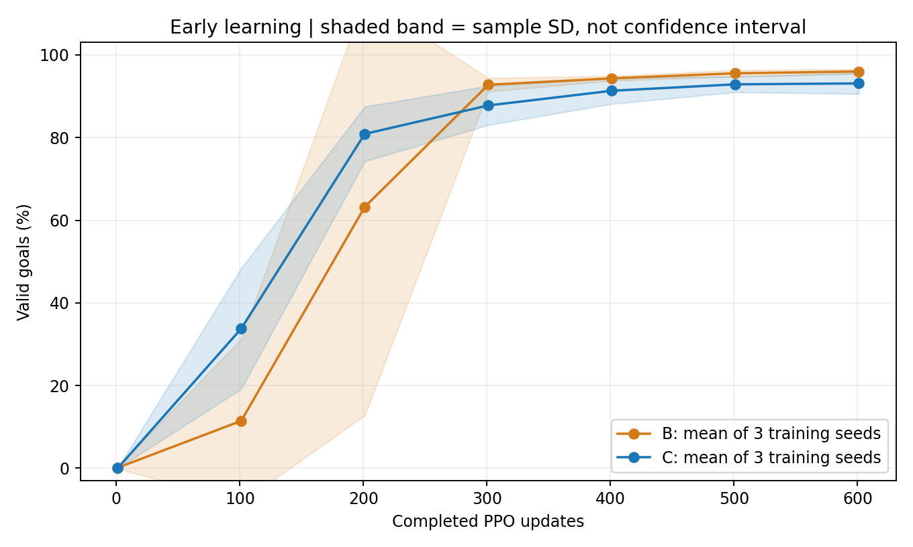

# B/C seeds 1–3：固定場景評測與 seed 2、3 完整 checkpoint

這包補上**單鴨射門**方法 B（PPO）、C（PPO＋reset curriculum）的 seed 2、3，並整理三個 training seeds 的比較。雙鴨對戰是另一個實驗。
這次只發布已完成的資料，沒有重新訓練、改評測或挑選最高分模型。最終結果一律使用 `model_1999.pt`。

## 先看結果

每個最終模型都用**同一份固定 100 組場景，各測 3 次＝300 局**；evaluation RNG seed 0。
下表時間只計成功進球局的平均，不包含未進球局。

| Training seed | B 進球數／300 | C 進球數／300 | B 進球率 | C 進球率 | B 成功時間 | C 成功時間 |
|---|---:|---:|---:|---:|---:|---:|
| 1 | 287 | 282 | 95.67% | 94.00% | 3.180 s | 3.321 s |
| 2 | 289 | 277 | 96.33% | 92.33% | 3.211 s | 3.416 s |
| 3 | 287 | 294 | 95.67% | 98.00% | 3.296 s | 3.148 s |

跨三個 training seeds，B 最終進球率 **95.89% ± 0.38 個百分點**，C **94.78% ± 2.91 個百分點**（平均 ± sample SD，非信賴區間）。
C 在 seed 3 勝過 B，但目前沒有證據說 C 穩定提高最終表現；也不能把三個 seeds 解讀成已證明統計顯著差異。

學習速度有不同面向：

- `model_100`（完成 101 次更新）平均進球率：B **11.44%**、C **33.78%**，有 C 前期較容易開始進球的跡象。
- 前 1～601 次更新的梯形近似平均曲線面積：B **67.56%**、C **72.20%**。
- 在已測存檔點首次觀察到 90%：B seeds 1/2/3 為 `model_200/300/200`，C 為 `model_400/500/300`。三個 seeds 都是 B 較早被觀察到達 90%。
- 所以可以說「C 有前期幫助的跡象」，目前不能說「C 整體學得更快」。這裡比較的是**學習速度**，不是 PPO 的 learning rate 超參數。





## 檔案在哪裡

| 路徑 | 用途 |
|---|---|
| [checkpoint_index.csv](checkpoint_index.csv)、[JSON](checkpoint_index.json) | 84 個 checkpoint 的相對路徑、SHA256、存檔編號、更新數與 CPU 檢查 |
| `checkpoints/B/seed2/`、`checkpoints/C/seed2/` | seed 2 的全部中途與最終 checkpoint |
| `checkpoints/B/seed3/`、`checkpoints/C/seed3/` | seed 3 的全部中途與最終 checkpoint |
| `runs/B_seed2/` 等四個資料夾 | 實際 `params/env.yaml`、`params/agent.yaml`、啟動設定、成功紀錄、完整訓練 console 與 TensorBoard 資料 |
| [protocol.json](protocol.json) | commit、固定題目 hash、官方技能 hash、評測設定及各評測索引 |
| [evaluation_set/soccer_eval_set.json](evaluation_set/soccer_eval_set.json) | 原固定 100 組場景，沒有重抽或換題 |
| `evaluations/seed{1,2,3}/{B,C}/model_{編號}/` | 每份官方 `summary.json`、原始 `per_episode.pt`、每局 CSV、驗證紀錄；新增評測附原 console |
| [analysis/final_results.csv](analysis/final_results.csv) | 六個最終模型的進球率與成功時間 |
| [analysis/final_time_stats.csv](analysis/final_time_stats.csv) | 依每局 CSV 計算的成功時間平均／中位數／p90 |
| [analysis/learning_curve.csv](analysis/learning_curve.csv)、[彙整](analysis/learning_curve_aggregate.csv) | 各 seed 和三 seed 平均的學習曲線 |
| [analysis/early_AUC.csv](analysis/early_AUC.csv)、[達標測點](analysis/early_thresholds.csv) | 前期曲線面積、70%／90% 的首次觀察 |
| [analysis/final_failure_combinations.csv](analysis/final_failure_combinations.csv) | 失敗旗標組合，避免重疊旗標被當成多局 |
| [analysis/subgroup_comparison.csv](analysis/subgroup_comparison.csv) | 距離、初始朝向、射門連線斜角的描述性分組 |
| [publication_validation.json](publication_validation.json) | 發布前 CPU 驗證結果 |
| [file_manifest.json](file_manifest.json) | 本包每個檔案的大小與 SHA256（manifest 本身除外） |

每次訓練保留 `model_0`、`100`、`200`…`1900`、`1999`，共 21 個；四次共 **84 個**，含 optimizer 與 normalization state，沒有只留 actor 權重。
存檔編號從 0 開始：`model_0` 已完成 **1 次 PPO 更新**，不是未訓練模型；`model_1999` 對應完成 2000 次。

本包共有 **48 份評測 × 300＝14,400 局**，包含 28 份當時新增、20 份重用資料。
這是 6 個訓練模型系列各 8 個測點（0、100…600、1999），**不是 14,400 次獨立訓練**。601～1999 之間的其他中途 checkpoint 已提供，但尚未新增評測。

## 版本與可比性

- Seed 2、3：commit **`1a8a1053533210d6695454cf51026551f3e4dbbc`**，每次 2048 環境、2000 iterations、training seed 2 或 3；四次皆從頭訓練。
- 沿用 seed 1 協定：rollout 24、4 minibatches、5 PPO epochs。兩方法的實際設定請看各 run 的 YAML。
- Seed 1 原訓練為 `7fa62987d76dd2ba00ec15ffdd1de5bd93480845`。新 commit 有 curriculum state 存取修正；[preflight](provenance/training/preflight.json) 記錄新訓練的共同 MDP、技能 adapter、constants 與 soccer config 核對。
- **沒有套用尚未合併 PR #4 的啟動 episode 計數修正**，因此本結果應稱「舊 seed 1 協定的三 seed 重複實驗」。請勿把 PR #4 的新版課程成果混進同一組。
- Python 3.12.14；套件及官方走路／右腳踢球 ONNX 的版本與 hash 見 `protocol.json`、各 run 的 `launch.json` 和 `provenance/source_snapshot/uv.lock`。
- 評測使用完整任務的 reset，**不啟用 C 的 reset curriculum**；固定題目 SHA256：`3a59dee2c22b5129fcb10685192630443a29550790ee5ccbffc04e414d053464`。
- 原 evaluator 會恢復 checkpoint clock，共用 CoM 物理隨機化隨 clock 改變。同一存檔點的 B/C 使用相同時程；不能說整條曲線所有物理條件都完全不變。
- C seed 1 曾從 `model_200` 恢復；舊 201～267 捨棄，物理 episode 與 RNG 重初始化。Seed 2、3 沒有這次恢復事件。

## 組員怎麼用

這個 PR 合併前，要切到結果分支：

```bash
git fetch origin
git switch joshua/bc-seeds-2-3-results
python results/soccer/bc_multiseed_20261121/verify_package.py
```

`verify_package.py` 只用 Python 標準函式庫，核對檔案 hash、84 個存檔索引、48 份逐局 CSV 和結果表；**不使用 GPU、不訓練**。
發布時另已在 CPU 載入全部 checkpoint，確認有限值、optimizer 更新數、存檔 clock 與最終權重確實改變。

要重新跑模擬評測時，請用 `protocol.json` 的固定檔與同版 evaluator，不要重新產生題目。原實際命令、CPU 載入 checkpoint／Warp 預載的隔離 wrapper 都保留於 `provenance/original_machine_wrappers/`；它們含原機器的絕對路徑，**是來源紀錄，換機執行前須調整路徑**。本 PR 沒有假稱這些歷史 wrapper 已變成跨機器的統一 CLI。
本次發布未重跑 GPU 評測；交付的是先前已完成、逐檔 hash 核對的正式資料。

Seed 1 的完整 checkpoint／更密集舊曲線仍見 [PR #3](https://github.com/8787greenhat/microduck_rl/pull/3)；此包保留三個 seeds 共用測點的全部評測，新增的 84 個 checkpoint 為 seed 2、3。

## 報告可用的結論與限制

目前資料支持「課程對早期開始進球可能有幫助，但沒有穩定提高最終成功率，也未讓高成功率門檻更早達成」。只有三個 training seeds；重複場景不是獨立訓練樣本。
達標時間只是在每 100 次存檔的共同測點首次觀察，不是精確 iteration；曲線面積是稀疏測點的描述性近似。
C 的 stage 2 仍有 20% reset 抽回較早階段；這不是 100% 完整任務 reset，也不是 20% 訓練步數。
角度與距離的分組只是描述性分析，各維度可能相關，不能直接推論因果。成功時間只計成功局。

`provenance/historical_local_reports/`、原 `analysis/plan.json` 等保留當時原文，其中「僅本機／未更新 GitHub」和 `github_updates=false` 描述的是 **2026-11-21 分析當時**；此 README 描述本次發布狀態。
