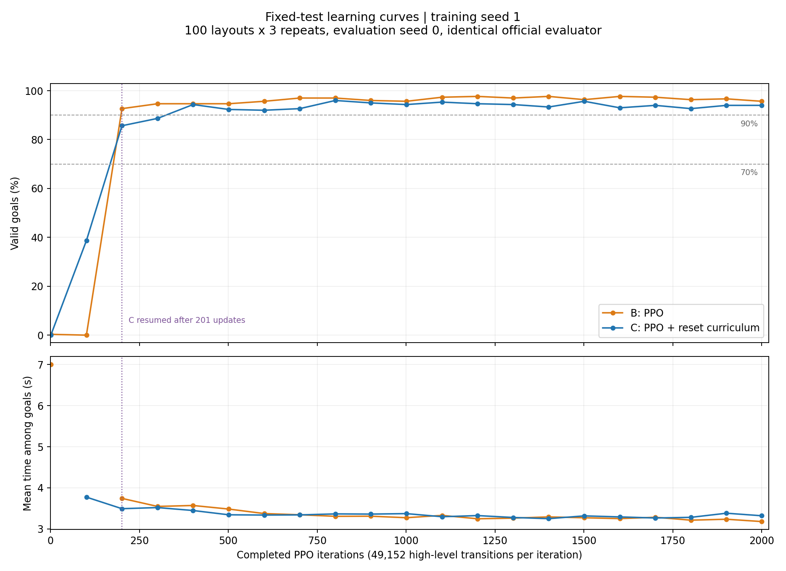

# B/C seed 1：固定考題的 checkpoint 學習曲線

**先看 [learning_speed.png](learning_speed.png) 和 [paired_comparison.csv](paired_comparison.csv)。**
沿用原本 100 個固定場景、各 3 次、evaluation RNG seed 0，在同一台 RTX 4060/WSL 評測 B、C 各 21 個存檔點。這次只有推論，沒有重新訓練或改評測程式。

| 項目 | B：PPO | C：PPO＋reset curriculum |
| --- | ---: | ---: |
| model_100 進球率 | 0/300（0%） | 116/300（38.7%） |
| 首次測得至少 70% | model_200 | model_200 |
| 首次測得至少 90% | model_200 | model_400 |
| 最終 model_1999 進球率 | 287/300（95.7%） | 282/300（94.0%） |
| 最終成功進球平均時間 | 3.180 秒 | 3.321 秒 |

C 在較早的存檔點先有進展；B 隨後追上，較早在存檔評測達到 90%。這是各一個 training seed 的結果，不能主張 curriculum 普遍更快或 B 這個演算法一定比較好。



## 這些數字代表什麼

- 共同存檔標號：0、100、200、…、1900、1999，共 21 個點。model_100 已完成 **101** 次 PPO 更新，model_0 已完成一次更新，不是未訓練模型。
- 每次更新是 2048 environments × 24 高階 steps = 49,152 transitions；兩個方法的同一存檔點有相同有效訓練預算。
- 每點評測 300 局：40 次新評測共 12,000 局，加上沿用的兩份原始最終評測 600 局，共 12,600 局；沒有重跑最終模型挑比較好的分數。
- 70%、90% 是執行前聲明的觀察門檻。每 100 次才有共同存檔，只能說「第一次測得」，無法知道精確收斂時間或未觀測間隔內有沒有起伏。
- 三次重複是同一份 policy 的場景重測，不是三個 training seeds。成功進球時間只統計進球局，需搭配進球率閱讀。
- 固定 JSON 的 SHA256：`3a59dee2c22b5129fcb10685192630443a29550790ee5ccbffc04e414d053464`。

## 保留的原流程與限制

正式 evaluator 與訓練來源 commit 都是 `7fa62987d76dd2ba00ec15ffdd1de5bd93480845`。原腳本會恢復 checkpoint 的 `common_step_counter`，共用的 trunk/head CoM 隨機化課程因此仍隨步數變化。**同一存檔點的 B/C 使用相同幅度；跨整條曲線的物理隨機化幅度並非固定不變。** 固定場景 JSON 始終相同，本次沒有為此修改舊評測。門檻與曲線應解讀為這個既有流程下的觀察。

C 曾從 model_200 恢復：保留原始 0–200，加恢復後 201–1999；捨棄的舊 201–267 和恢復短測試不納入。恢復時物理 episode/RNG 與舊 curriculum counters 重初始化，不是逐位元等同不中斷的 run；完整訓練紀錄見 [C seed 1 原始結果](../c_seed1_20261025/README.md)。

執行時有 3 次未完成的原生程序崩潰（B model_300 兩次、B model_1800 匯入 PyTorch 一次），證據在 [provenance](provenance)。model_300 起改由 CPU 反序列化再載入 GPU，34 次新評測均逐張量核對 actor 與正規化狀態完全相同。保留所有首次完成結果，沒有以重跑挑分數。偶發崩潰根因尚未完全定位，不將 CPU 讀檔做法描述成已根治系統不穩。

## 檔案

| 路徑 | 用途 |
| --- | --- |
| [paired_comparison.csv](paired_comparison.csv) | 每個存檔點 B/C 進球數、成功時間與配對結果 |
| [learning_curve.csv](learning_curve.csv) | 每方法／存檔一列，含失敗旗標、時間與訓練量 |
| [all_per_episode.csv](all_per_episode.csv) | 全部 12,600 局；layout 0–99，repeat 1–3 |
| [comparison_summary.json](comparison_summary.json) | 達標點、探索性曲線面積與限制 |
| [evaluations](evaluations) | 42 份官方 summary、逐局 PT/CSV、verification；40 份新評測日誌 |
| [evaluation_set](evaluation_set) | 原固定 JSON 與 manifest |
| [inputs/checkpoint_manifest.json](inputs/checkpoint_manifest.json) | 全部 42 份來源 checkpoint 雜湊與位置 |
| [C 的 21 份存檔 ZIP](inputs/method_C_seed1_selected_checkpoints.zip) | 本次用到的 C 模型；包含 model_1999，不是全部 76 份存檔 |
| [protocol.json](protocol.json) | 不含本機 job 路徑的評測設定與來源 |
| [provenance](provenance) | 原始執行計畫、完成稽核、環境版本、故障紀錄與原機器 wrapper |
| [繁體中文完整報告](seed1_learning_speed_report_zh.txt) | 21 點結果與解讀限制 |

B 的 21 份原始模型已在 [PR #1 的固定 commit](https://github.com/8787greenhat/microduck_rl/tree/348f703d2bcbb7fc0fcb64db940fc13bd7ed887f/results/soccer/b_seed1_comparison_20261025/checkpoints) 提供；本 PR 用 manifest 指向原檔，避免重複收錄。

## 不用 GPU 的資料核對

在 repo 根目錄執行（只用 Python 標準函式庫）：

```bash
python results/soccer/bc_seed1_checkpoint_eval_20261025/reproducibility/verify_and_plot.py
```

若已安裝 repo 鎖定的 PyTorch，可加 `--tensors`，在 CPU 解開 42 份 PT，逐局比對 CSV；這不會呼叫模擬器或訓練。

若環境已有鎖定依賴中的 matplotlib，可加 `--plot`，只用 CPU 從 CSV 重畫到新檔，不覆蓋原圖：

```bash
python results/soccer/bc_seed1_checkpoint_eval_20261025/reproducibility/verify_and_plot.py --plot /tmp/bc_seed1_curve.png
```

重新做模擬評測時，請在獨立的 `7fa6298` checkout 使用原 `scripts/eval_soccer.py`、相同官方技能與 `uv.lock`；把此包固定 JSON 放到該 checkout 的 `data/soccer_eval_set.json`，核對 hash，指定 `--episodes 100 --repeats 3 --seed 0`，輸出到全新資料夾。WSL610.62 的 library path 與 Warp 預載方式保留在原 wrapper。`provenance/original_machine_wrappers` 含當時的本機絕對路徑，只是執行證據，不能直接當成跨機器 CLI。

本資料包的逐檔 SHA256 列在 `file_manifest.json`；原始 `final_audit_before_publication.json` 的「未上傳」與本機路徑是當時紀錄，這份歷史證據保持原樣。
